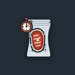
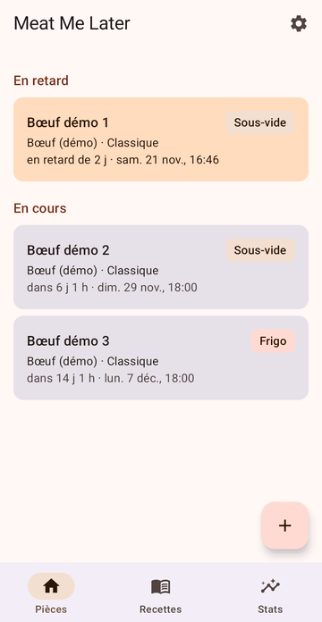
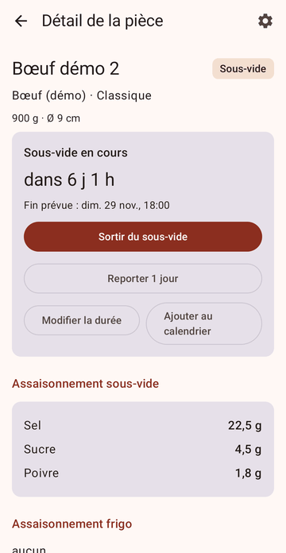
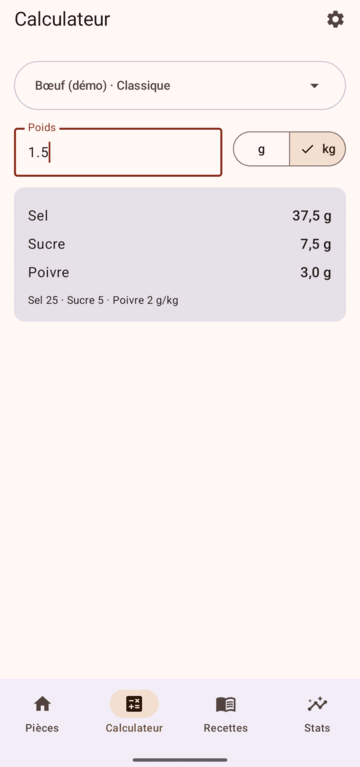
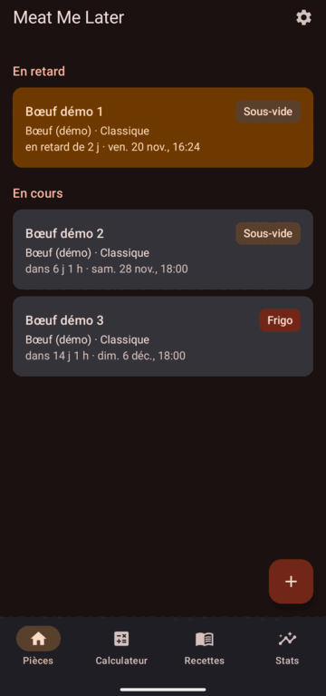

<div align="center">



# Meat Me Later

**Plan, dose and track your dried meats. The app reminds you when each piece is ready to come out.**

[](https://github.com/bataillec/dried-meats/actions/workflows/ci.yml)
[](https://github.com/bataillec/dried-meats/releases/latest)
[-3DDC84?logo=android&logoColor=white)](docs/requirements.md)
[](docs/decisions/0001-toolchain-versions.md)
[](docs/decisions/0001-toolchain-versions.md)
[](docs/decisions/0001-toolchain-versions.md)

</div>

Meat Me Later is an Android app for home dried-meat preparation (beef, pork, duck, and any meat you add).
It computes the salt, sugar and pepper for each piece, schedules a reliable reminder for the end of each stage
(vacuum, then fridge drying) and keeps the history of how long each stage really took.

Everything stays on the phone: no account, no network access, no analytics. The interface is in French.

## Screenshots

<p align="center">
  
  
  
  
</p>

_Sample data on an emulator. Left to right: piece list (overdue first), piece detail, calculator, dark theme._

## Features

- **Dosage calculator**: enter a weight (g or kg) and pick a recipe to get the grams of salt, sugar and pepper
  (recipes are expressed in g/kg). Works standalone.
- **Recipes and meat types**: beef, pork and duck are pre-seeded; add your own meats and recipes, duplicate or
  archive them. Fridge seasoning is free text.
- **Pieces in parallel**: each piece has a label, recipe, weight and diameter. The vacuum duration is computed from
  the diameter (diameter in cm / 2 + 1 days, adjustable per piece). Doses and durations are snapshotted at
  creation, so later recipe edits never change a running piece.
- **Stage reminders**: one notification at the planned end of each running stage, with "Fait" and
  "Reporter 1 jour" actions. The fridge stage has a 14-day minimum (configurable); after that you check the piece
  by touch and postpone a day at a time until it is ready.
- **Reliable alarms**: reminders are stored as absolute timestamps and rebuilt after reboot, app update and
  time-zone or clock changes. Overdue pieces are pinned on top of the list when you open the app.
- **History and statistics**: actual start and end of every stage, free-text notes per stage, and average real
  durations per meat type and recipe.
- **Backup**: export all data to a JSON file and import it back.
- **Calendar hand-off** (optional): "Ajouter au calendrier" opens your calendar app with the stage end date;
  the app itself never requests calendar access.
- **Themes**: Clair, Sombre, Sombre OLED, or Système.

The full list is in [`docs/requirements.md`](docs/requirements.md) (R1 to R26, N1 to N8).

## Installation

The app is distributed only through [GitHub Releases](https://github.com/bataillec/dried-meats/releases)
(no Play Store).

1. On your phone, download the latest `.apk` from the Releases page.
2. Open it. When Android asks, allow installs from this source (the browser or file manager you used)
   — "Install unknown apps".
3. Launch **Meat Me Later**. Installing a newer APK over the previous one keeps your data.

Requires Android 8.0 (API 26) or newer. To make reminders fire on time, grant when asked:

- **Notifications** (Android 13+), so reminders can be shown;
- **Exact alarms**, so they fire at the planned minute;
- **Battery optimisation exemption** ("Désactiver l'optimisation de batterie"), so Android does not delay them
  after days in the background. The home screen shows a banner while one of these is missing.

## Development

### Setup

Tools are managed with [mise](https://mise.jdx.dev); always go through `mise run` or `mise exec --` rather than
calling `java`, `gradle` or `sdkmanager` directly.

```bash
mise install        # JDK 25, Android command-line tools, jq, ktlint
mise run doctor     # toolchain check, must print OK
mise run setup      # accept SDK licences, install platform and build-tools
mise run check      # lint + unit tests + 90 % domain coverage gate
```

Other tasks:

```bash
mise run build      # debug APK -> app/build/outputs/apk/debug/app-debug.apk
mise run test       # JVM unit tests (domain, data, receivers)
mise run lint       # ktlint, detekt and Android lint
mise run format     # auto-format Kotlin sources
mise run release    # signed release APK (signing values come from the environment)
```

Versions of the toolchain (JDK 25, Gradle 9.x, AGP 9.5, Kotlin 2.4, Room 3, compileSdk 37) are recorded in
[`docs/decisions/0001-toolchain-versions.md`](docs/decisions/0001-toolchain-versions.md).

### Project layout

```
app/src/main/java/me/bataillec/meatmelater/
  domain/     pure Kotlin: dosage, durations, stage state machine, reminder planning
  data/       Room database, DAOs, settings store, JSON backup
  platform/   alarms, receivers, notifications, permission banner
  ui/         Jetpack Compose screens (pieces, calculator, recipes, stats, settings, theme)
docs/         intent, requirements, design, decisions, assumptions, device checklist
scripts/      icon generation and Claude Code hooks
```

### Architecture rules

- Layers: `ui` → `domain` ← `data`; `platform` sits beside them.
- `domain` has no Android imports and reads time only through an injected `Clock`.
- Dose maths uses `BigDecimal` (`HALF_UP`, 0.1 g); weights are stored as integer grams.
- The database is the source of truth for reminders; alarms are a rebuildable cache. Anything that changes a
  stage run ends with `ReminderPlanner.reconcile()`.
- Stage actions go through `PieceActions`; UI and receivers never write stage runs directly.
- No network or calendar permission (R20, R22). All user-visible text is French, in string resources.

The complete rules live in [`CLAUDE.md`](CLAUDE.md).

## Tests

- `mise run check` is the gate before any commit and runs in CI: ktlint, detekt, Android lint, JVM unit and
  Robolectric tests, and a Kover coverage threshold of 90 % on `domain`.
- Emulator tests (real alarm, battery wizard, dialogs) need a running emulator:

  ```bash
  mise exec -- ./gradlew connectedDebugAndroidTest
  ```

- Before a release, run the manual [device checklist](docs/device-checklist.md) on a real phone (Doze, reboot,
  vendor battery killers).
- To fill a fresh install with sample pieces (for screenshots or manual checks), run
  `DemoDataSeederTest` with `-e seedDemo true`; see the comment at the top of the test.

## Documentation

| Document | Content |
|---|---|
| [`docs/intent.md`](docs/intent.md) | What the app is for and its constraints |
| [`docs/requirements.md`](docs/requirements.md) | Numbered functional (R) and non-functional (N) requirements |
| [`docs/design.md`](docs/design.md) | Architecture and design |
| [`docs/decisions/`](docs/decisions/) | Decision records (toolchain versions) |
| [`docs/assumptions.md`](docs/assumptions.md) | Choices made while building |
| [`docs/device-checklist.md`](docs/device-checklist.md) | Manual release test and last run |
| [`CHANGELOG.md`](CHANGELOG.md) | Release notes |

## Contributing

Small pull requests, one concern each. Reference requirement ids (R4, N5, ...) in test names and PR descriptions,
write domain tests first, and make sure `mise run check` passes. Schema changes need a Room migration and a
migration test. A new dependency needs a line in `docs/decisions/`. A release is made by pushing a `vX.Y.Z` tag
(see `.claude/skills/release/`).

## License

No license has been chosen yet, so all rights are reserved by the author.
